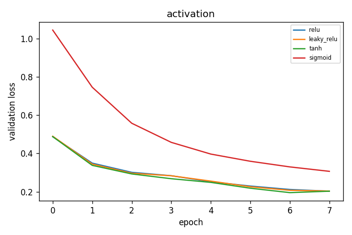
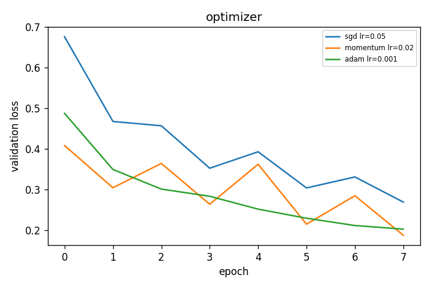
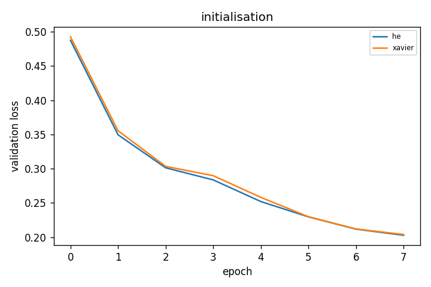
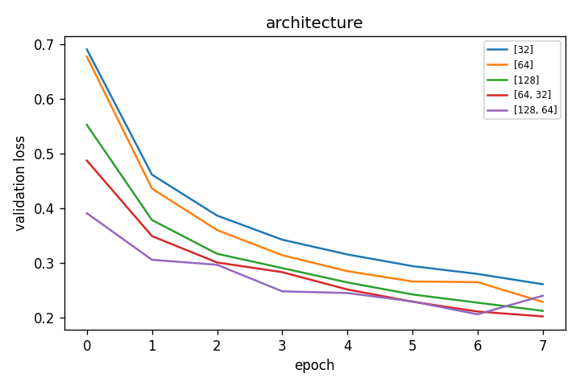
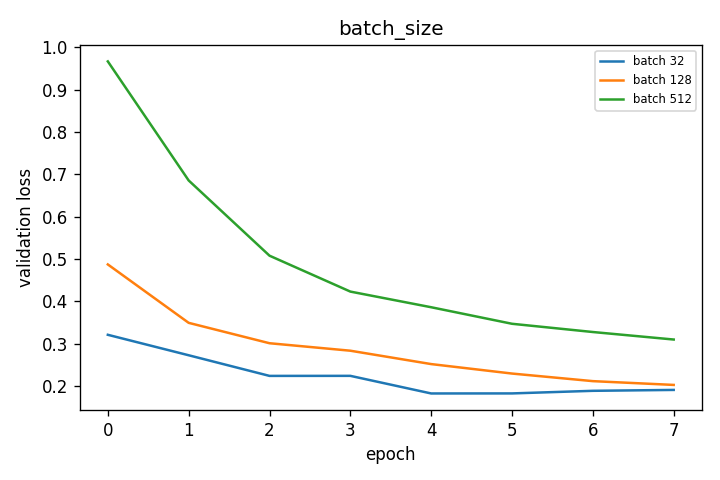
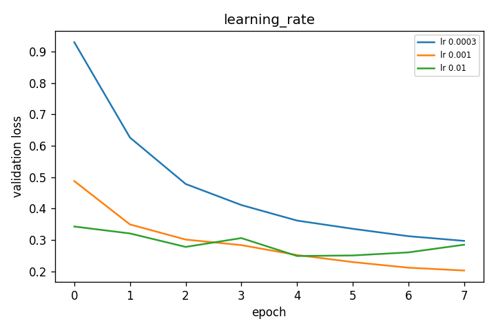
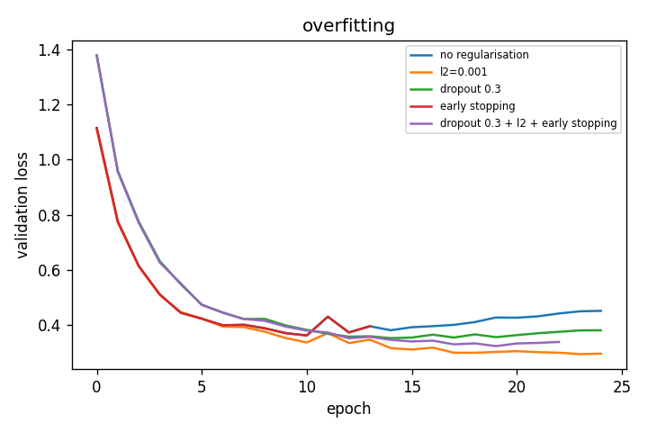

# Benchmarks

## activation

| variant | train acc | val acc | test acc | epochs | final train loss | best val loss | seconds |
|---|---|---|---|---|---|---|---|
| relu | 0.964 | 0.919 | 0.920 | 8 | 0.144 | 0.203 | 40.5 |
| leaky_relu | 0.966 | 0.914 | 0.921 | 8 | 0.146 | 0.203 | 39.9 |
| tanh | 0.962 | 0.924 | 0.920 | 8 | 0.147 | 0.195 | 39.4 |
| sigmoid | 0.909 | 0.877 | 0.875 | 8 | 0.287 | 0.306 | 40.8 |

## optimizer

| variant | train acc | val acc | test acc | epochs | final train loss | best val loss | seconds |
|---|---|---|---|---|---|---|---|
| sgd lr=0.05 | 0.905 | 0.884 | 0.881 | 8 | 0.308 | 0.269 | 39.0 |
| momentum lr=0.02 | 0.959 | 0.923 | 0.931 | 8 | 0.165 | 0.188 | 40.2 |
| adam lr=0.001 | 0.964 | 0.919 | 0.920 | 8 | 0.144 | 0.203 | 40.4 |

## initialisation

| variant | train acc | val acc | test acc | epochs | final train loss | best val loss | seconds |
|---|---|---|---|---|---|---|---|
| he | 0.964 | 0.919 | 0.920 | 8 | 0.144 | 0.203 | 40.6 |
| xavier | 0.961 | 0.917 | 0.917 | 8 | 0.154 | 0.204 | 36.2 |

## architecture

| variant | train acc | val acc | test acc | epochs | final train loss | best val loss | seconds |
|---|---|---|---|---|---|---|---|
| [32] | 0.928 | 0.891 | 0.892 | 8 | 0.232 | 0.262 | 18.5 |
| [64] | 0.952 | 0.907 | 0.907 | 8 | 0.187 | 0.229 | 39.3 |
| [128] | 0.960 | 0.916 | 0.908 | 8 | 0.161 | 0.213 | 75.5 |
| [64, 32] | 0.964 | 0.919 | 0.920 | 8 | 0.144 | 0.203 | 38.7 |
| [128, 64] | 0.988 | 0.920 | 0.916 | 8 | 0.074 | 0.207 | 79.7 |

## batch_size

| variant | train acc | val acc | test acc | epochs | final train loss | best val loss | seconds |
|---|---|---|---|---|---|---|---|
| batch 32 | 0.970 | 0.936 | 0.924 | 8 | 0.078 | 0.183 | 42.7 |
| batch 128 | 0.964 | 0.919 | 0.920 | 8 | 0.144 | 0.203 | 39.1 |
| batch 512 | 0.911 | 0.870 | 0.860 | 8 | 0.275 | 0.310 | 39.7 |

## learning_rate

| variant | train acc | val acc | test acc | epochs | final train loss | best val loss | seconds |
|---|---|---|---|---|---|---|---|
| lr 0.0003 | 0.910 | 0.877 | 0.875 | 8 | 0.268 | 0.297 | 38.0 |
| lr 0.001 | 0.964 | 0.919 | 0.920 | 8 | 0.144 | 0.203 | 36.3 |
| lr 0.01 | 0.956 | 0.897 | 0.902 | 8 | 0.086 | 0.249 | 38.0 |

## overfitting

| variant | train acc | val acc | test acc | epochs | final train loss | best val loss | seconds |
|---|---|---|---|---|---|---|---|
| no regularisation | 1.000 | 0.843 | 0.847 | 25 | 0.017 | 0.363 | 31.1 |
| l2=0.001 | 1.000 | 0.863 | 0.857 | 25 | 0.032 | 0.295 | 30.1 |
| dropout 0.3 | 0.997 | 0.858 | 0.838 | 25 | 0.104 | 0.353 | 26.9 |
| early stopping | 0.976 | 0.830 | 0.833 | 14 | 0.091 | 0.363 | 12.0 |
| dropout 0.3 + l2 + early stopping | 0.990 | 0.857 | 0.842 | 23 | 0.145 | 0.324 | 16.7 |

