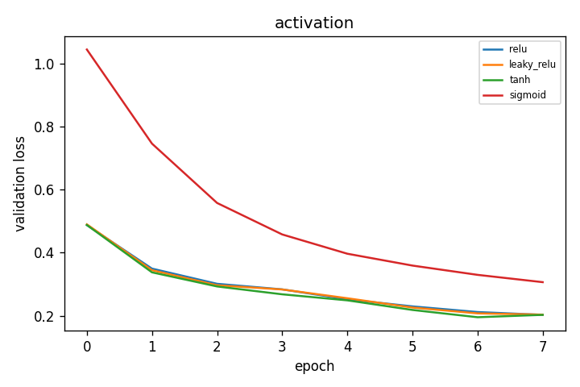
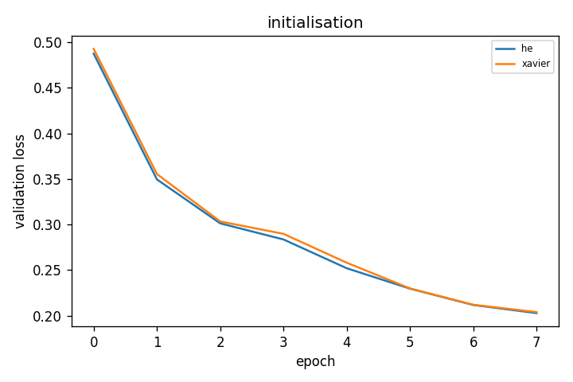
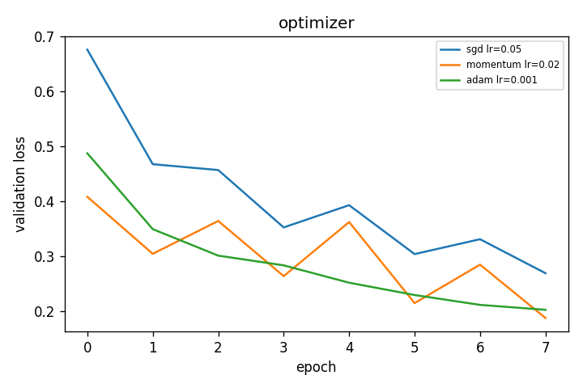
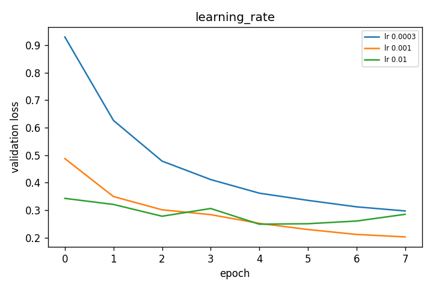
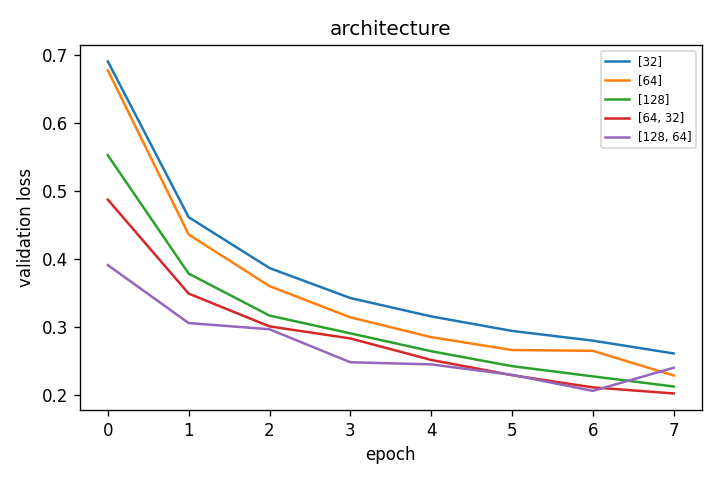
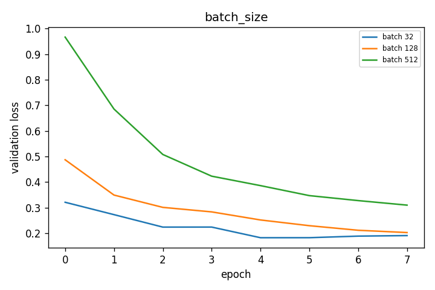
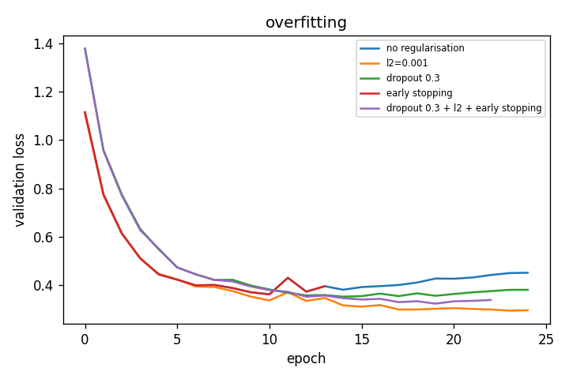
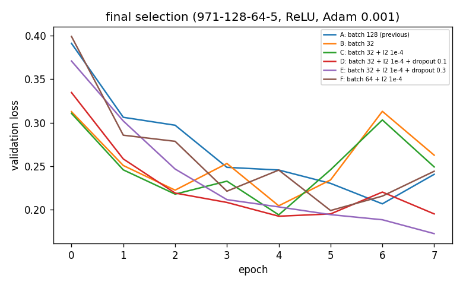
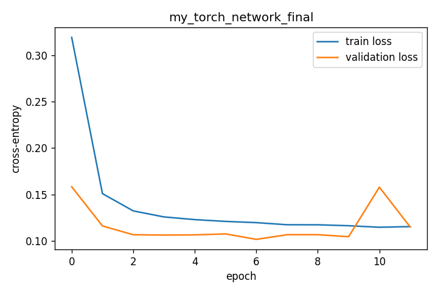

# Chosen configuration

Network `my_torch_network_full.nn`, trained with
`scripts/train.py --limit 200000 --hidden 128 64 --activation relu --dropout 0.3 --optimizer adam --lr 0.001 --batch-size 32 --l2 0.0001 --epochs 25 --patience 5`.
Everything below comes from `scripts/benchmark.py` (one variable at a time, 24 000
positions, 8 epochs, seed 0), `scripts/final_selection.py` (combinations) and
`bonus/hyperparameter_search.py` (random search). Raw numbers are in `logs/`.

| hyperparameter | value |
|---|---|
| input | 971 features |
| hidden layers | 128 then 64 neurons |
| hidden activation | ReLU |
| output | 5 neurons, softmax |
| initialisation | He (hidden), Xavier (output) |
| loss | cross-entropy |
| optimiser | Adam, learning rate 0.001 |
| batch size | 32 |
| L2 | 0.0001 |
| dropout | 0.3 after each hidden layer |
| early stopping | patience 5, best weights restored |
| training data | 200 000 balanced positions (160 000 train / 20 000 validation / 20 000 test) |

## Why each value

### Hidden activation: ReLU



| activation | test accuracy |
|---|---|
| ReLU | 0.920 |
| leaky ReLU | 0.921 |
| tanh | 0.920 |
| sigmoid | 0.875 |

ReLU, leaky ReLU and tanh are equivalent; sigmoid is clearly worse because its
derivative is at most 0.25, so the gradient shrinks at each layer. ReLU is the
cheapest to compute and does not saturate for positive values.

### Initialisation: He (Xavier on the output)



He gives 0.920 and Xavier 0.917 with ReLU: inside the noise, but consistent with
the theory (He compensates the half of the signal that ReLU removes). On the XOR
test, a constant scale of 0.01 left the loss stuck at 0.25. The output layer is
followed by a softmax, not a ReLU, so it uses Xavier.

### Optimiser: Adam, learning rate 0.001





| optimiser | test accuracy | | learning rate | test accuracy |
|---|---|---|---|---|
| SGD (0.05) | 0.881 | | 0.0003 | 0.875 |
| momentum (0.02) | 0.931 | | 0.001 | 0.920 |
| Adam (0.001) | 0.920 | | 0.01 | 0.902 |

SGD is the slowest. Momentum and Adam are close; Adam needs much less tuning.
0.0003 is too slow for the epoch budget and 0.01 is unstable (lower training
loss, higher validation loss).

### Architecture: 128 then 64



| hidden layers | test accuracy | train accuracy |
|---|---|---|
| 32 | 0.892 | 0.928 |
| 64 | 0.907 | 0.952 |
| 128 | 0.908 | 0.960 |
| 64, 32 | 0.920 | 0.964 |
| 128, 64 | 0.916 | 0.988 |

Capacity helps then saturates. On 24 000 positions the largest network already
overfits (train 0.988, test 0.916). It is kept because the final training set is
more than eight times larger, and it is regularised by dropout and L2.

### Batch size: 32



| batch | test accuracy |
|---|---|
| 32 | 0.924 |
| 128 | 0.920 |
| 512 | 0.860 |

With a fixed number of epochs, a smaller batch means more updates. The random
search agrees: its best runs all use a batch of 32 or 64. The cost per epoch is
about the same here.

### Regularisation: dropout 0.3, L2 0.0001, early stopping



On 6 000 positions, with 25 epochs, the plain network reaches train 1.000 and
validation 0.843. L2 0.001 improves it (0.863); early stopping mostly saves time
(14 epochs instead of 25). The two other values come from the combined
comparison on the chosen architecture:



| candidate | val accuracy | best val loss |
|---|---|---|
| A: batch 128 | 0.920 | 0.207 |
| B: batch 32 | 0.920 | 0.204 |
| C: B + L2 1e-4 | 0.923 | 0.194 |
| D: C + dropout 0.1 | 0.921 | 0.192 |
| **E: C + dropout 0.3** | **0.935** | **0.172** |
| F: batch 64 + L2 1e-4 | 0.919 | 0.199 |

E has the best validation loss and is the only curve that is still decreasing
at the last epoch, while the others oscillate. It is also the setting of the
best random-search run (dropout 0.3, L2 1e-4, batch 32). This comparison uses
one seed and the curves oscillate, so part of E's advantage may be noise.

## Result of the final training



12 epochs run (17 minutes), best weights from epoch 7.

| set | accuracy |
|---|---|
| train | 0.965 |
| validation | 0.963 |
| test (20 000) | 0.964 |
| held-out (25 000 positions used by no network) | 0.963 |

The previous network (same architecture, batch 128, no regularisation, 150 000
positions) gets 0.958 on the same 25 000 held-out positions: a gain of 0.45
point, smaller than the 1.5 points suggested by the 24 000-position comparison.
It is kept in `bonus/my_torch_network_batch128.nn`.

Confusion matrix on the 25 000 held-out positions (rows: truth, columns:
prediction, order `Nothing`, `Check White`, `Check Black`, `Checkmate White`,
`Checkmate Black`):

```
[[5043,    0,    0,    0,    0],
 [   0, 4540,    0,  506,    0],
 [   0,    0, 4580,    0,  390],
 [   0,   11,    0, 4996,    0],
 [   0,    0,   25,    0, 4909]]
```

## What the results tell us

- Training and validation accuracy are almost equal (0.965 and 0.963): the
  network does not overfit. The validation loss is below the training loss
  because dropout is active during training only.
- The remaining errors are all a check predicted as a checkmate of the same
  colour, and the reverse. The limit is the information given to the network
  (it estimates the king's escape squares but does not simulate blocking or
  capturing the checking piece), not the training.
- The validation loss jumps at epoch 11 (0.158) before recovering: with a learning
  rate of 0.001 and a batch of 32, training is a little unstable. A learning-rate
  schedule is a lead; early stopping returned the weights of epoch 7.

## Limits

One seed per run, a test set from the same generator as the training set, a
balanced dataset (real games contain mostly `Nothing`), and no stalemate.
